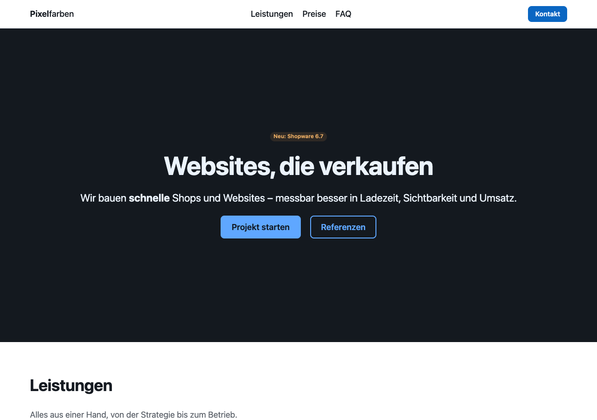
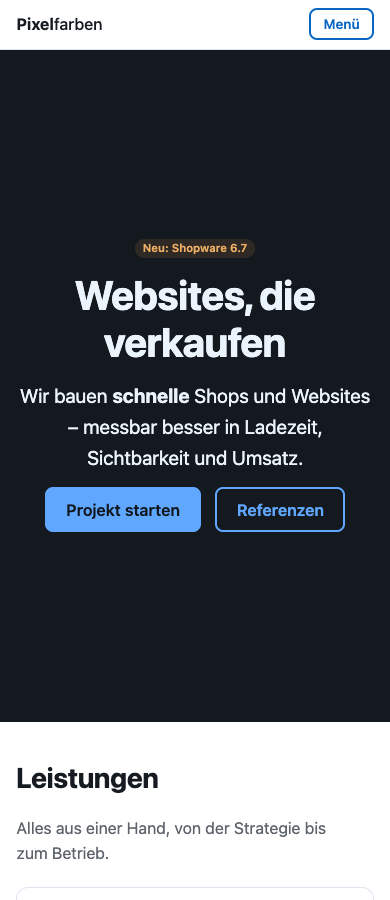

# nextcss

**HTML and CSS were built for humans. nextcss is the same web, rebuilt for AI.**

nextcss is one language for structure and style. You describe *what* a page is: a hero, a section, a grid of cards, a form. The compiler produces static HTML and minimal CSS with no JavaScript. It handles contrast, heading levels, responsive layout, lazy loading and accessibility.

```
page "Pixelfarben – Webdesign" lang:de
theme brand:#0a66c2

header sticky
  link "**Pixel**farben" plain to:/
  nav hide:narrow
    link "Leistungen" to:#leistungen
    link "Preise" to:#preise
  button "Kontakt" opens:kontakt size:s

hero tone:inverse align:center
  title "Websites, die verkaufen"
  text "Wir bauen **schnelle** Shops und Websites."
  row align:center
    button "Projekt starten" opens:kontakt
    button "Referenzen" to:#referenzen variant:outline

section#preise tone:subtle
  title "Preise"
  grid cols:3
    card
      title "Basic"
      text "**ab 2.900 €**"
      list marker:check
        item "Bis 5 Seiten"
      button "Anfragen" full opens:kontakt

dialog#kontakt
  title "Projekt anfragen"
  form to:/api/kontakt
    field "E-Mail" required type:email
    button "Senden" submit
```

| Desktop | Phone |
|---|---|
|  |  |

The full example is [`examples/landing/index.ncss`](examples/landing/index.ncss) (111 lines). The compiled page is [`index.html`](examples/landing/index.html). There is not a single media query in the source.

## Why

An AI model writes in one pass from top to bottom, cannot see what it renders, thinks in intent and pays per token. HTML and CSS work against all four.

| HTML/CSS makes the model… | nextcss instead |
|---|---|
| **…reason globally.** How an element looks depends on selectors in other files, on specificity and on the cascade. | An element looks like its own line says. There are no selectors and no classes. |
| **…guess pixels.** `padding: 23px`, `z-index: 999`, breakpoints. | Scales (`gap:l`) and color *pairs* (`tone:primary`). Contrast is guaranteed at compile time. |
| **…write mechanism.** `display:flex; justify-content:space-between` | Intent: `bar`, `split`, `grid min:16rem`, `cover`. Every layout adapts by itself. |
| **…remember chores.** `alt` text, labels, h1 → h2 → h3, focus styles. | These are part of the language. Heading levels follow from nesting, and a missing `alt` is a compile error. |
| **…write boilerplate.** Closing tags, wrapper divs, JavaScript for menus and dialogs. | One line per element. `menu`, `dialog` and `fold` compile to the Popover API, `<dialog>` and `<details>`. |
| **…pick one of ten ways.** | One canonical form (`nextcss fmt`). The vocabulary is closed and every error names the fix. |
| **…work blind.** | `nextcss inspect` renders the page and tells you, as text, what came out. |

## Results

Measured with `npm run bench` on the landing page above (tokens: `o200k_base`):

| | bytes | LLM tokens | lines |
|---|---|---|---|
| nextcss source | 3,450 | **944** | 111 |
| HTML + CSS for the same page | 19,435 | 6,214 | 746 |

The page needs **6.6× fewer tokens to write and to read**. The HTML + CSS baseline is the compiler output, formatted the way a person writes it. Hand-written code for the same design would be similar in size, but it would not have the fluid type scale or the contrast-checked palette for free.

| Delivered page | raw | gzip | brotli |
|---|---|---|---|
| HTML with inline CSS, one request | 16.0 KB | 4.6 KB | 4.0 KB |

- **JavaScript: 0 bytes.** The menu, dialog and accordion use platform features.
- **CSS: 10 KB raw / 2.8 KB gzip.** Only the rules the page uses are emitted, so the size is bounded by the vocabulary, not by the number of pages.
- **Images** get `width`/`height` (no layout shift) and lazy loading below the fold.

**Contrast.** For every brand color in the test set, every text color pair in all 8 tones reaches at least 4.5:1 (WCAG AA). This includes yellow, cyan, near-white and near-black brand colors.

**Lossless migration.** Three hand-written pages are imported into nextcss and compiled back. They are verified in Chrome to have the same DOM, the same computed style on every element (including `::before`/`::after`) and the same pixels. The check runs at every CSS breakpoint ±1 px, in light, dark and print mode, and with forced hover. The pages are a blog with an external stylesheet, a form with inline styles, and a float/inline-block layout.

## Quick start

```bash
git clone https://github.com/vlpmedialtd/nextcss.git && cd nextcss
npm install && npm run build
node dist/cli.js build examples/landing/index.ncss
```

| Command | What it does |
|---|---|
| `nextcss build <file\|dir>` | HTML (+ CSS: inline if small, else a hashed file; one shared file for a site) |
| `nextcss check <files>` | errors and warnings with fixes (`--json` for agents) |
| `nextcss fmt <files> --write` | canonical form |
| `nextcss inspect <file>` | render in headless Chrome and describe the result as text |
| `nextcss import page.html` | HTML/CSS → nextcss, same rendering |
| `nextcss convert <file>` | line format ⇄ JSON |
| `nextcss schema` | JSON Schema of the JSON form, for structured output / constrained decoding |
| `nextcss docs` | the whole language in about 1,850 tokens (same as [`llms.txt`](llms.txt)) |

### Errors that say how to fix them

```
page.ncss:2:3: error: unknown role "titel" – did you mean "title"?
page.ncss:3:8: error: gap:large – expected a space step: none 2xs xs s m l xl 2xl 3xl – did you mean "l"?
page.ncss:4:5: error: image needs alt:"…" (what it shows), or the flag decorative
```

### Eyes for the model

```
$ nextcss inspect examples/landing/index.ncss
Outline
  h1 "Websites, die verkaufen"  L21
    h2 "Leistungen"  L28
      h3 "Performance"  L32
…
At 375px – page is 3124px tall
  ✓ nothing wider than the screen
  L30 grid min:15rem  →  1 column × 3 rows
  L71 split valign:center ratio:3/2  →  1 column × 2 rows
  ✓ all text readable (lowest contrast 5.44:1 at L60 <button> "Anfragen")
  ✓ all buttons and links are at least 24×24px
At 1280px – page is 2586px tall
  L30 grid min:15rem  →  3 columns × 1 row
  L71 split valign:center ratio:3/2  →  2 columns × 1 row
…
No problems found.
```

`inspect` exits with code 1 when it finds problems: overflow, low contrast, small tap targets or broken images. An agent can iterate until the exit code is 0.

## The language in one minute

- **Lines.** One line is one element and indentation is nesting: `role#id "text" flags key:value`.
- **Text.** Strings support `**bold**`, `*italic*`, `` `code` ``, `[links](/url)` and inline roles `{badge "neu"}`. Long-form content goes into `prose` as Markdown.
- **Layout.** `stack row bar split grid sidebar center cover layer`, plus the regions `header nav main section hero aside footer`.
- **Content.** `title text prose list item quote code image video icon table card badge alert divider`.
- **Actions and interaction.** `link`, `button` (`to`, `opens`, `closes`, `submit`), `fold`, `accordion`, `menu`, `dialog`.
- **Forms.** `form field check option`. Labels, names and hints are wired up for you.
- **Design.** `theme brand:#… font:… radius:… density:… dark:auto`. Every color, space and text size is derived from it.
- **Reuse.** `define Card(title)` plus `slot`, and `use "./parts.ncss"`.
- **Escape hatches.** `css:"…"` (scoped to one element, supports nesting), `name=value` raw attributes, `el <any-tag>`, raw `html` and `css` blocks.

The full spec is in [`spec/SPEC.md`](spec/SPEC.md) and the complete vocabulary in [`llms.txt`](llms.txt). Both come from one schema, [`src/schema.ts`](src/schema.ts).

### JSON form

Every document has an equivalent JSON form. With `nextcss schema` as the response schema, a model can only produce valid pages.

```json
{ "role": "section", "tone": "subtle", "children": [
  { "role": "title", "text": "Preise" },
  { "role": "grid", "cols": "3", "children": [ { "role": "card", "children": [ { "role": "text", "text": "ab 2.900 €" } ] } ] }
] }
```

## Migrating

| Direction | How |
|---|---|
| **nextcss → HTML/CSS** | `nextcss build` produces ordinary, readable HTML and CSS. You can stop using nextcss at any time. |
| **HTML/CSS → nextcss** | `nextcss import page.html` writes a `page plain` file that renders exactly like the original. |

The importer:

- maps elements to roles where the rendering is identical, and uses `el <tag>` otherwise,
- turns inline styles into `css:"…"`,
- keeps stylesheets verbatim in a low cascade layer,
- keeps only the whitespace that actually renders,
- writes anything it cannot express exactly as raw `html`.

From there, a person or an AI can lift the page to roles and tones piece by piece. Each step can be checked with the same visual comparison the tests use.

## Status

v0.1 is a working compiler, importer, formatter and inspector, with unit and visual tests. Planned next:

- Data loops (`each`) for lists from JSON.
- Tabs and a carousel.
- An icon set.
- A precise importer mode that asks the browser which whitespace renders.
- A Vite plugin and editor syntax highlighting.

## Development

```bash
npm test               # unit tests
npm run test:visual    # HTML → nextcss → HTML round trip in Chrome (needs Google Chrome)
npm run bench          # tokens and bytes
npm run docs           # regenerate llms.txt from the schema
```

MIT licensed.
